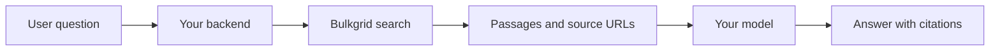

Keep Bulkgrid credentials in your backend or worker. Your frontend sends requests to your application, which enforces user access and calls Bulkgrid.

## Customer-facing search

Send a search request from your backend and display returned titles, passages, and source URLs in your UI. Handle empty results explicitly and measure relevance among the first results.

Node.js and Python examples use the [Bulkgrid SDKs](/sdk). Set `BULKGRID_API_KEY` in your backend environment; cURL examples also use `BULKGRID_BASE_URL=https://bulkgrid.com`.

<CodeGroup>

```js Node.js
import { BulkgridClient } from '@bulkgrid/sdk';

const client = new BulkgridClient({
  apiKey: process.env.BULKGRID_API_KEY ?? '',
  baseUrl: process.env.BULKGRID_BASE_URL ?? 'https://bulkgrid.com',
});

const data = await client.index.search({ query: 'pricing', limit: 5 });
// Return data.results from your backend handler.
```

```python Python
import os
from bulkgrid import BulkgridClient

with BulkgridClient(
    api_key=os.environ["BULKGRID_API_KEY"],
    base_url=os.environ.get("BULKGRID_BASE_URL", "https://bulkgrid.com"),
) as client:
    data = client.index.search({"query": "pricing", "limit": 5})
    print(data)
```

```bash cURL
curl "${BULKGRID_BASE_URL:-https://bulkgrid.com}/api/v1/index/search" \
  -H 'Content-Type: application/json' \
  -H "x-api-key: $BULKGRID_API_KEY" \
  -d '{"query":"pricing","limit":5}'
```

</CodeGroup>

Use a key restricted to the relevant collections. See [Index](/index) for query options and [Collections](/collections) for access boundaries.

## RAG and AI agents

Retrieve relevant passages with search, pass them to your model as grounding, and include their source URLs in the answer. Keep retrieved results distinct from generated answers and provide a fallback when no relevant content exists.



For direct agent connections, use [MCP](/mcp-server).

## Keep knowledge current

1. Add a website source, subscribe to an existing public source, or add a GitHub repository.
2. Configure the source's content boundaries and refresh schedule.
3. Check source status and indexed document counts.
4. Add the source or selected documents to a collection.
5. Grant an API key or OAuth client access to that collection and query search.

See [Sources](/sources) and [Collections](/collections).

## Export content to your own system

For a one-off export, create a crawl or extraction run, poll it, and retrieve results. Store the outputs in your own system if needed. Do not assume a one-off run establishes a persistent source subscription.

## Background jobs

For crawl, deep crawl, and extraction, create the run in your backend and persist its ID with the customer's context. Poll in a background worker with a bounded wait, then retrieve the outputs. Expose job status to your frontend instead of holding a request open indefinitely.

See [Runs and results](/runs-and-results) for polling, retrieval, and recovery. Track ingestion failures and validate content quality before expanding source coverage.
