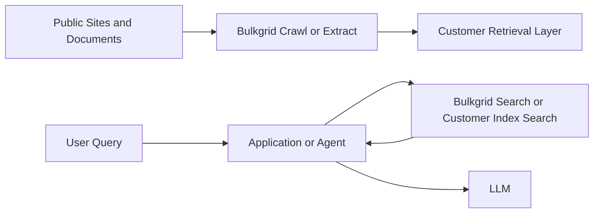

Bulkgrid fits naturally into retrieval-augmented generation and agent workflows because it supports both content ingestion and direct retrieval.

## Common pattern

## Where Bulkgrid helps most

- crawling and normalizing source content
- extracting structured information from pages
- returning ranked search results for downstream answer generation
- keeping ingestion logic out of your agent runtime

## Practical recommendation

Keep agent logic focused on reasoning and tool orchestration. Keep content ingestion and retrieval mechanics in Bulkgrid plus your backend layer.
