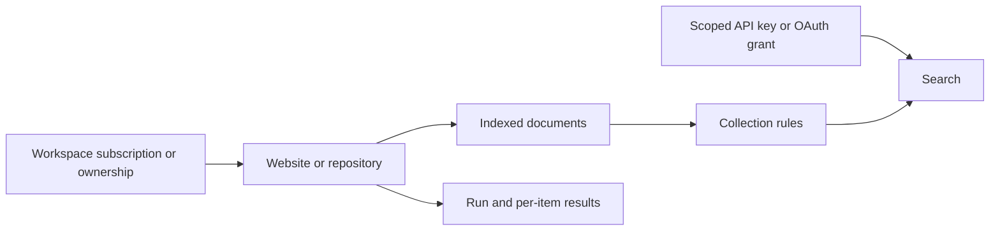

## Workspace

A workspace owns your configuration and access boundaries. API keys belong to one workspace. OAuth connections select one workspace during consent and retain that binding when reauthorized.

## Source

A source is a persistent website or repository origin whose documents can be indexed and refreshed. Public website sources can be shared across workspaces through subscriptions. Private sources and GitHub sources are workspace-owned.

Subscribing to a shared source gives your workspace a relationship to existing content; it does not transfer ownership of the global source. See [Sources](/guides/source-management).

## Collection

A collection selects the content available to a retrieval workflow. Rules include or exclude sources, folders, or URLs. Applications can search one collection, and credentials can restrict access to selected collections.

## Run and result

A run tracks asynchronous work: `crawl`, `deep_crawl`, `extract`, or `source_sync`. Its status can be `pending`, `processing`, `completed`, `failed`, or `cancelled`.

Results record per-item outputs and errors. A completed run can still contain individual failed items. Use source indexing status to confirm content is searchable; completion of a one-off crawl is not a substitute for checking the source's indexed documents.

## Connection

An API key or OAuth grant connects a client to a workspace with explicit permissions. OAuth grants appear in Connected Apps and can be revoked. CLI login and an AI app's MCP login are separate connections.

